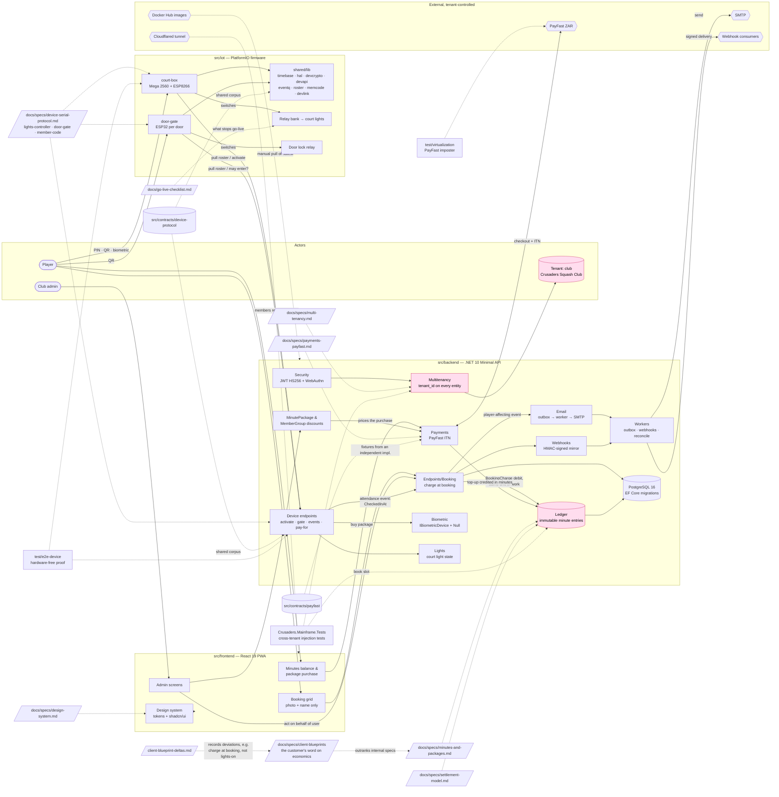

# Crusaders Mainframe

Multi-tenant SaaS for racquet-sport club court-light scheduling on a credit + on-court biometric model. First customer: **Crusaders Squash Club**.

A FrostAura Technologies project. Strategic context, charter, feature spec, design system, biometric/lights/payments specs, and deploy story all live in [`CLAUDE.md`](./CLAUDE.md) and [`docs/`](./docs/).

## Stack
- **Backend:** ASP.NET Core 10, EF Core, PostgreSQL 16, JWT + Passkeys
- **Frontend:** React 19 + TypeScript + Vite + Tailwind, shadcn/ui on Radix, light and dark themes — tokens and components per [`docs/specs/design-system.md`](./docs/specs/design-system.md).
- **Payments:** PayFast (ZAR), per-tenant merchant credentials — see [`docs/specs/payments-payfast.md`](./docs/specs/payments-payfast.md). Pinned against a fixture corpus generated by an independent implementation ([`src/contracts/payfast/`](./src/contracts/payfast/))
- **Biometric peripheral:** abstracted via `IBiometricDevice` — see [`docs/specs/biometric-abstraction.md`](./docs/specs/biometric-abstraction.md)
- **Lights:** WeMos Mega 2560 + ESP8266 court box driving a 4-channel relay board on the club LAN — see [`src/iot/court-box/README.md`](./src/iot/court-box/README.md)
- **Doors:** one ESP32 per door — QR scanner, one relay on the lock — asking the same API who may come in — see [`src/iot/door-gate/README.md`](./src/iot/door-gate/README.md)
- **Deploy:** GitHub Actions → multi-arch images → Docker Hub, where **CI stops by decision** — there is no redeploy job. Pulling the published `:latest` manifests onto the club machine is a **manual** step, and so are the two stack checks the removed job used to make; members reach it through a Cloudflared tunnel — see [`docs/specs/deployment.md`](./docs/specs/deployment.md) and [`docs/go-live-checklist.md`](./docs/go-live-checklist.md) §2

## Quick start (local dev)
```bash
cp .env.example .env       # then edit secrets
make install               # restore backend + npm install frontend
make up                    # docker compose: backend + frontend + postgres + mailhog + gateway
```

App: http://localhost:8088 · Mailhog: http://localhost:8025

## Common tasks
```bash
make build            # lint + build backend, frontend and all three firmware targets
make test             # unit tests: backend, frontend and firmware
make test-integration # postgres-backed boundary tests — real SQL, real migrations
make test-iot-asan    # the firmware suite under ASAN + UBSAN
make test-e2e         # Playwright, mobile and desktop
make complexity       # cyclomatic complexity across C++, C# and TypeScript
make virt-up          # fake PayFast + device simulator, as plain processes
make down             # stop stack
make down-reset       # stop and clear volumes
```

`make test-integration` needs `API_BOUNDARY_TEST_CONNECTION_STRING`; without it those tests
skip, which is correct everywhere except the job that exists to run them — see
`REQUIRE_BOUNDARY_TESTS`.

## Layout
```
src/backend/    .NET 10 solution (Api + Tests)
src/frontend/   React + Vite + Tailwind, hand-rolled component primitives
src/iot/        Firmware tree — one PlatformIO project per device plus shared/
                (court-box/ is the ATmega2560 + ESP8266 court light box)
src/contracts/  Wire-protocol corpus shared by the firmware and backend tests
test/           e2e-device/ (the hardware-free end-to-end proof) and
                virtualization/ (the PayFast imposter and its docs)
docs/           Charter + specs (canonical reference)
.github/        CI workflow
nginx/          The gateway: nginx.conf plus the Dockerfile that bakes it in
Makefile        The entry point for every task — there is no scripts/ directory
```

## Knowledge graph

How the pieces relate. Nodes are the system's parts; edges are labelled with the relationship.
Solid edges are runtime data flow; dotted edges are "specified by" / "verified by" links into
`docs/`, `src/contracts/` and the test suites. Every node is a path in this repository or a
named external party.



### Invariants the graph encodes

| Node | Invariant |
| --- | --- |
| Ledger | Balance is the sum of immutable entries, never a stored field. Whole minutes are the unit; rand appears only where money changed hands. |
| Book → Ledger | The booking row and its `BookingCharge` debit flush together. Cancellation refunds in full less the late-cancel penalty; once `CheckedInAt` is set there is no refund. |
| MT / Tenant | Every persisted entity carries `tenant_id`; every endpoint resolves the tenant first. Cross-tenant leakage is a P0 incident. |
| Dev → Book | The at-court identification event is the source of truth for attendance; a no-show is the absence of a match inside the grace window. |
| Mail | Email only ever queues; the worker sends. Webhooks mirror the same events and never replace player email. |
| Grid | Other players see photo and name only. |
| Box / Gate | The court box's Mega is a thin I/O layer; volatile logic lives on the ESP8266. Anything a generated Arduino sketch links must be valid C++11 as well as C++17. |

### Reading paths

- **Money:** `minutes-and-packages.md` → `settlement-model.md` → `Ledger` → `payments-payfast.md` → `src/contracts/payfast`
- **Lights:** booking → `Dev` → `lights-controller.md` → `device-serial-protocol.md` → `court-box` → relay bank
- **Doors:** `door-gate.md` → `member-code.md` → `Dev` → `door-gate` → lock relay
- **Tenancy:** `multi-tenancy.md` → `Multitenancy/` → cross-tenant tests in `Crusaders.Mainframe.Tests`

## Before this goes live

Every phase is built and the suites are green — which is not the same as done, and this
repository has the receipts: three adversarial passes have each found real defects in code
that was already passing. The one kept on disk as evidence is
**[`docs/reviews/adversarial-e2e-review.md`](./docs/reviews/adversarial-e2e-review.md)** —
its finding ids are what the device end-to-end suite and this checklist decode against. What
each later round established lives in the memory store, not in a report.

What remains beyond that needs physical access, a live credential, or a person's decision —
including one **safety** question about whether the relays switch a contactor or the
lighting load directly, which gates everything else.

**[`docs/go-live-checklist.md`](./docs/go-live-checklist.md)** is the list, ordered by what
stops go-live first, with the consequence of skipping each item written next to it.

## License
[MIT](./LICENSE) · © FrostAura Global (Pty) Ltd.
